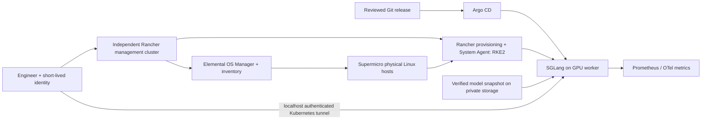

# Architecture: Elemental-managed bare-metal demonstrator

## Vision and baseline

Demonstrate repeatable, private LLM inference on physical Supermicro hardware with an
operator-readable build, test and recovery path. The current baseline is a design archive and
README; no hardware inventory, deployed cluster or live evidence was supplied. The target is a
single-tenant synthetic-data lab. Business success means an engineer other than the author can
provision, explain, test and recover it using the kit.

## Topology and ownership

| Layer | Single accountable workflow | Boundary |
|---|---|---|
| BIOS/BMC/firmware | Hardware engineer, approved vendor process | Inventory and change record; no automated reset in this kit |
| OS install, registration, image update | Elemental/OS Manager | Independent management cluster; TPM-backed registration |
| RKE2 configuration and upgrades | Rancher provisioning + System Agent | Uses Elemental inventory; no direct install scripts |
| Host NVIDIA driver | Signed/verified Elemental-compatible host image | GPU Operator driver.enabled=false |
| Device toolkit, plugin, DCGM | GPU Operator | Rendered through Argo CD after initial bootstrap |
| Downstream Kubernetes objects | Argo CD after explicit adoption | Fleet excludes these paths; no Helm-controller duplicate |
| External DNS/IPAM/LB/registry | Existing platform; Terraform if requested | No credentials or guessed provider modules |
| Models and licenses | Model owner | Exact revision, full file hashes, read-only serving mount |

## Sizing assumptions (not measured capacity)

Minimum workload cluster: one physical server with 4+ CPU/16 GiB RAM and enterprise SSD,
plus one GPU worker with 16+ CPU/128 GiB RAM, at least 200 GiB free model/cache NVMe,
and one supported NVIDIA GPU with at least 80 GiB VRAM. Provide a separate already-supported
Rancher management cluster; it is not bootstrapped by the cluster it will provision.
The CPU server can host demo system add-ons but never the GPU-serving workload. There is no
quorum resilience with one server and no serving availability while the sole GPU is maintained.

Qwen3.6-27B BF16 weights alone are roughly 54 GB (decimal); runtime buffers and KV cache add
memory. The initial profile caps context at 4096 and active requests at two, with TP=1 and one
replica. These conservative limits demonstrate API behavior, not the model's long-context
capability. Verify model loading and peak HBM on the actual GPU. Smaller GPUs require an
independently evaluated quantized/smaller-model profile, not silent CPU offload.

For HA: three servers across failure domains, separate CPU workers, two GPU workers with a full
model copy each, capacity for N-1, and a tested private gateway/load balancer. Extend per-host
registrations and local PV affinity deliberately. Replicas and tensor parallelism are different:
two replicas can serve independently; TP=2 needs a compatible two-device topology per replica.

## Data, security and storage

Separate BMC/PXE, management, workload and storage networks. Restrict BMC to operator access.
Workload nodes need management HTTPS; RKE2 requires API 6443 and supervisor 9345 reachability,
plus peer/CNI/kubelet ports from the selected release's network requirements. Never open etcd
2379/2380 to clients. Record actual CIDRs/MTU/firewall rules in site inventory, not in generic defaults.

The model source is a private verified mirror; an existing read-only PVC exposes the materialized
snapshot at /model. No downloads or trust_remote_code at serving startup. Local NVMe is replaceable;
retain the authoritative model and evidence externally. For a local PV, use Retain and exact node
affinity; Elemental OS reset must not erase the model or backup disk accidentally.

The demo endpoint is ClusterIP and reachable for smoke via localhost kubectl port-forward.
RBAC controls who can establish the tunnel. The demo has no client OIDC gateway, per-tenant quota,
or multi-tenant isolation; those are prerequisites for wider access. A default-deny policy
permits only labeled observability pods to reach the serving port. That port serves both metrics
and inference: observability readers are therefore trusted API clients. Separate them behind a
metrics proxy before relaxing that trust. NetworkPolicy is L3/L4, not HTTP authorization.

## Inference and telemetry

Use SGLang metrics and NVIDIA DCGM without prompts/completions. The included OTel configuration
is metrics-only and is an optional collection path; Prometheus can scrape directly instead.
Do not enable both paths for the same series without deduplication. Trace SDK instrumentation,
Honeycomb export, dashboards and privacy canaries need their own validated extension. Host and
application logs require redaction review; disabling content telemetry is not proof logs are safe.
HBM prefix cache is single-tenant. CPU/HiCache/distributed cache remains disabled pending isolation,
latency, memory and retention tests. Backstage, MLflow and KServe are outside the request path and
outside the implemented minimal demo.

## Failure behavior

Management-plane loss should not stop existing inference, but prevents lifecycle changes.
Registry/model-store failure must not stop a warm replica; a replacement may remain unavailable.
A GPU failure or node drain stops the single replica. Recovery is a prior immutable manifest,
retained model snapshot and verified host image through Elemental/Rancher. Never claim a
Kubernetes version downgrade is a safe rollback; restore/rebuild under the vendor procedure.
